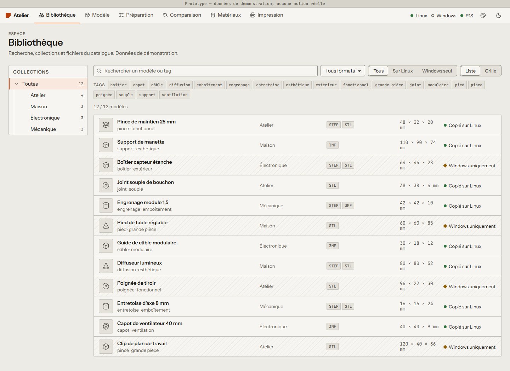
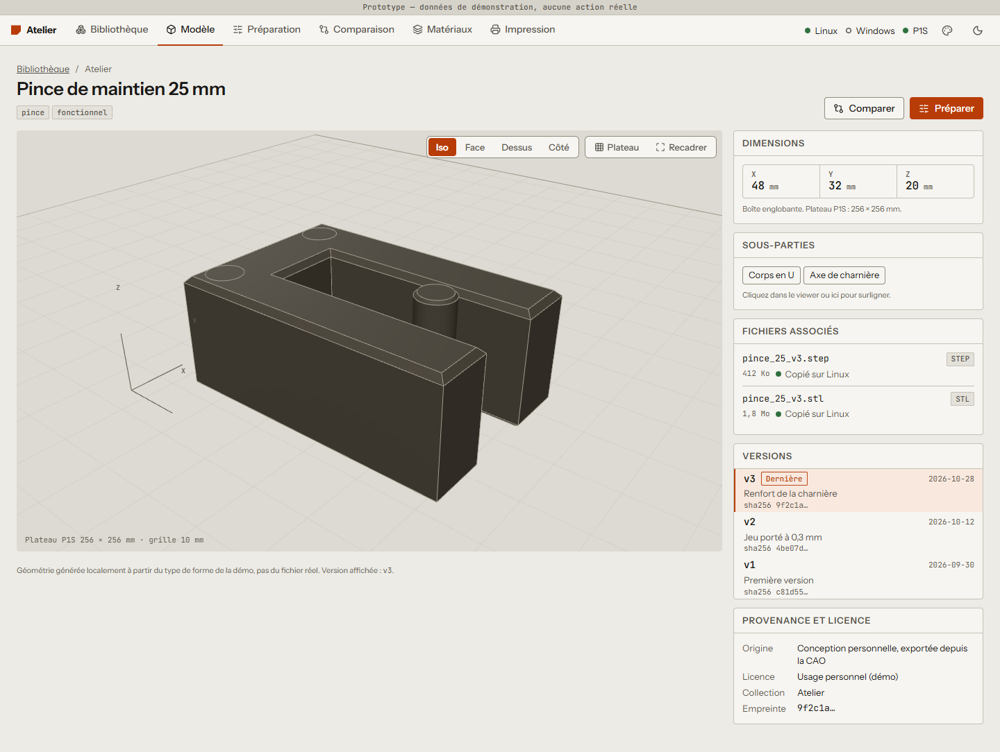
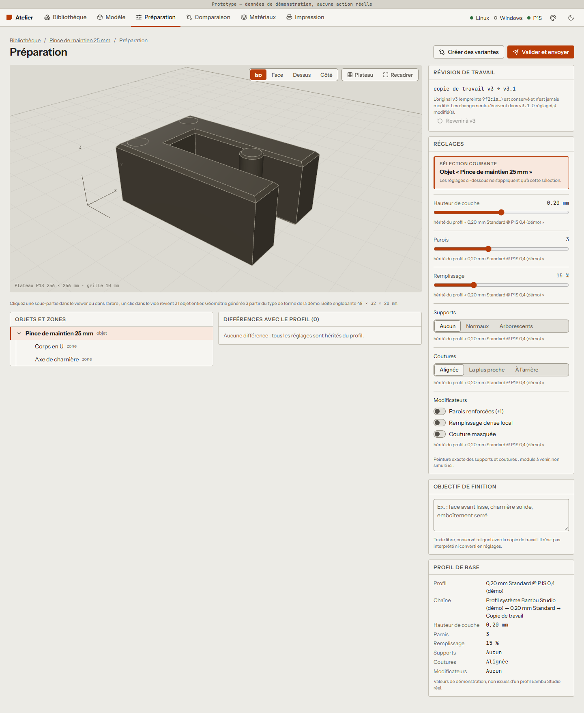
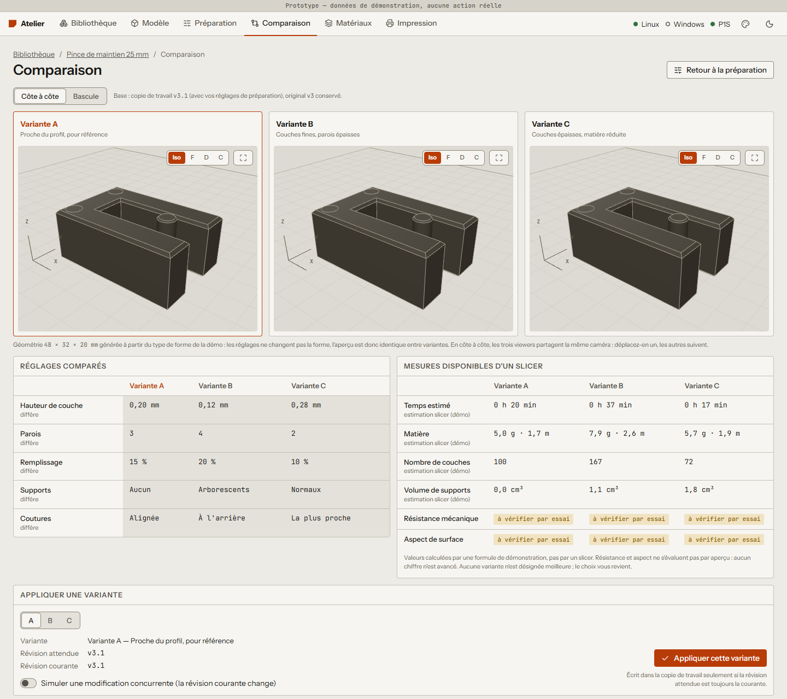
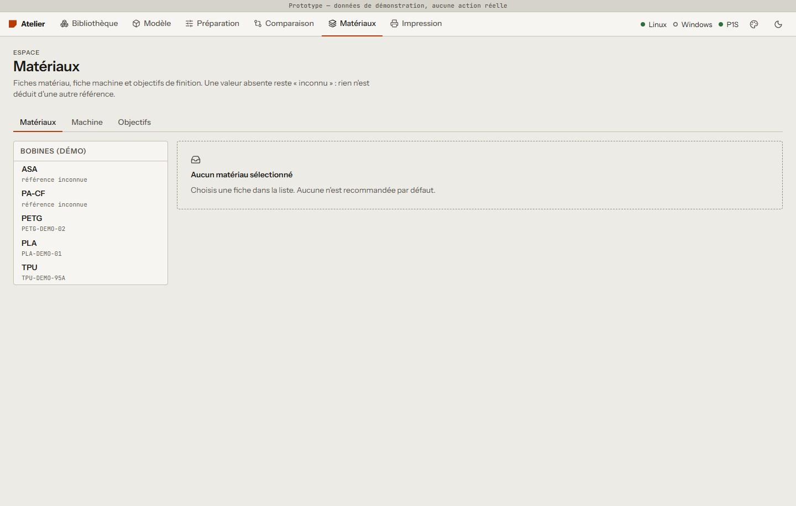
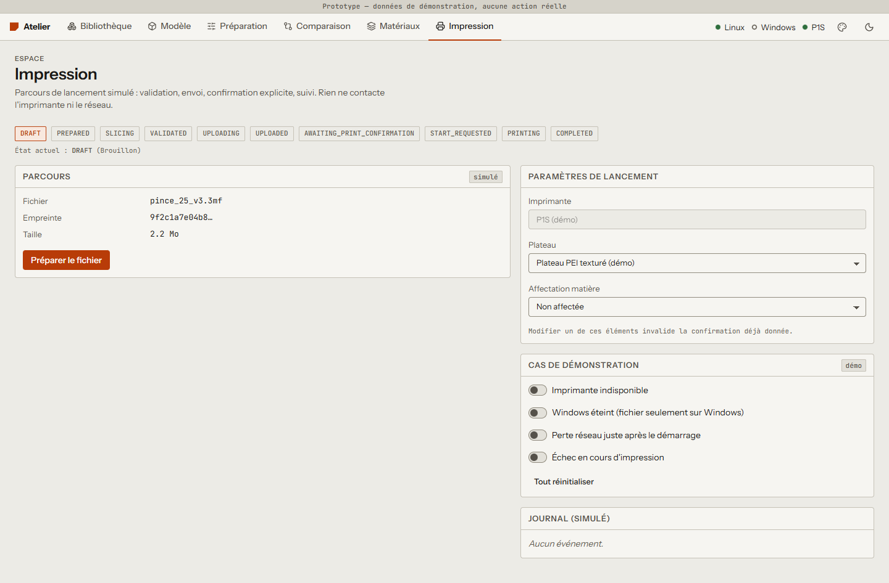
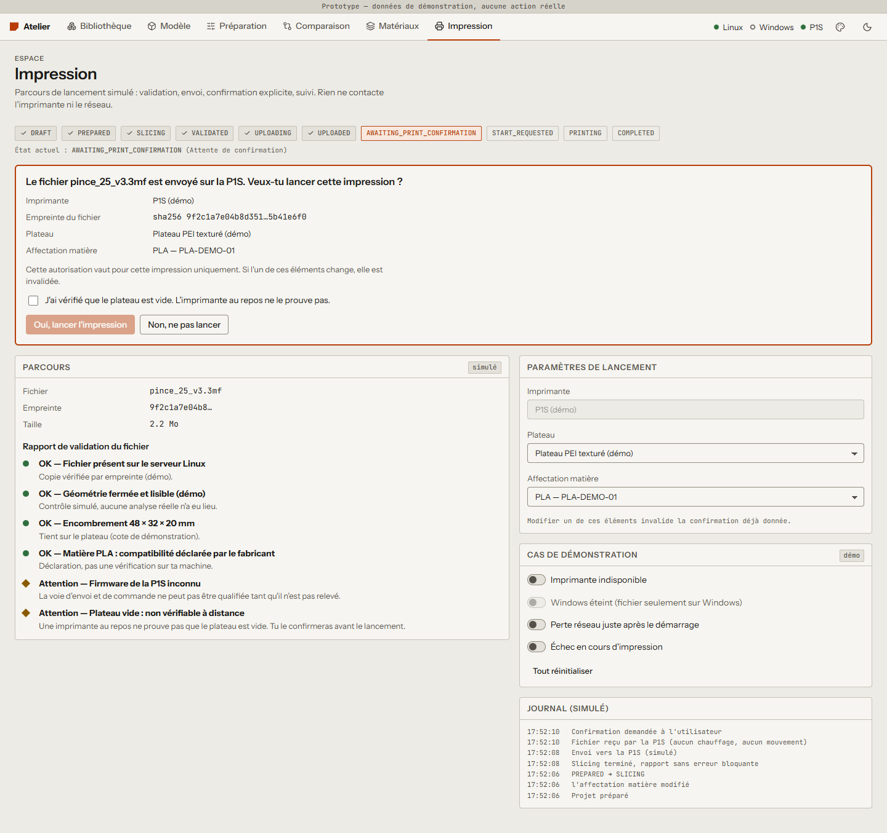

# Parcours annoté — prototype D0

Prototype navigable (`prototype/`), données de démonstration, aucune action réelle. Captures à 1440 px, thème clair ; les mêmes écrans existent en `-sombre` dans `captures/`. Régénération : `node scripts/capture.mjs` depuis `prototype/`.

Point d'entrée : `/` ([01-accueil-clair.png](captures/01-accueil-clair.png)) liste les six étapes du parcours.

## 1. Retrouver / importer — `/bibliotheque`

Arborescence de collections, recherche texte, filtres par format, par disponibilité (copié sur Linux / Windows seul) et par tag, vue liste ou grille. Les fichiers « Windows uniquement » sont hachurés et portent un losange ambre doublé d'un texte. Recherche « pince » : [02b-bibliotheque-recherche-clair.png](captures/02b-bibliotheque-recherche-clair.png) ; une recherche sans résultat affiche un état vide avec sortie (réinitialiser les filtres).

## 2. Inspecter — `/modele/m01`

Viewer 3D local (rotation, zoom, vues standard, recadrage), sélection d'une sous-partie dans le viewer ou la liste, fichiers avec leur état de copie, versions (le sélecteur de version change la révision de l'aperçu : moins de chanfreins sur les anciennes). Un fichier non copié affiche un bandeau « aperçu issu du cache » dans le viewer.

## 3. Préciser le résultat — `/preparation`

Arbre objet / zones, réglages hérités du profil (couche, parois, remplissage, supports, coutures, modificateurs) applicables à la sélection courante, tableau des différences avec le profil, objectif de finition en texte libre conservé tel quel. Les réglages sont écrits dans une copie de travail (v3 → v3.1) ; l'original v3 n'est jamais modifié. « Créer des variantes » mène à l'étape suivante.

## 4. Comparer — `/comparaison`

Trois variantes côte à côte avec **caméra partagée** : déplacer l'un des viewers déplace les deux autres, les boutons de vue standard aussi. Tableau des réglages (les lignes qui diffèrent sont signalées), mesures d'estimation étiquetées « démo », résistance et aspect marqués « à vérifier par essai » sans chiffre. L'application d'une variante vérifie la révision attendue : l'option « simuler une modification concurrente » produit un conflit de version qui n'écrase rien et propose de relire la révision courante.

## 4 bis. Matière et objectifs — `/materiaux`

Fiches matériaux dont les champs inconnus sont affichés « inconnu » (jamais remplacés par la valeur d'une autre référence), compatibilité P1S « déclarée » ou « non démontrée », décomposition d'un objectif en critères.

## 5. Préparer / envoyer — `/impression`

Machine à états : brouillon, préparé, slicing, validé, envoi, envoyé. Un rapport de validation distingue erreurs bloquantes, avertissements et confirmations. Cas de démonstration activables : imprimante indisponible, Windows éteint (fichier seulement sur Windows), perte réseau après démarrage, échec en cours d'impression.

## 6. Confirmer le lancement

Le lancement exige une autorisation explicite, valable pour cette impression seulement (imprimante, empreinte du fichier, plateau, matière) et une case « plateau vide » cochée par la personne. Changer plateau ou matière invalide l'autorisation. Suivi après lancement : [07c-impression-suivi-clair.png](captures/07c-impression-suivi-clair.png) (couche, temps, températures simulés ; annulation possible).

## Vue compacte dans une conversation — `/claude`

Quatre tours d'une conversation **illustrative simulée** ; seul le cadre du widget est maquetté. Un interrupteur simule « fonction UI indisponible » (repli texte).

| Tour | Clair | Sombre |
|---|---|---|
| 1 · Recherche | [clair](captures/09-claude-tour1-clair.png) | [sombre](captures/09-claude-tour1-sombre.png) |
| 2 · Fiche (viewer 3D, sous-parties) | [clair](captures/09-claude-tour2-clair.png) | [sombre](captures/09-claude-tour2-sombre.png) |
| 3 · Comparaison | [clair](captures/09-claude-tour3-clair.png) | [sombre](captures/09-claude-tour3-sombre.png) |
| 4 · Envoi | [clair](captures/09-claude-tour4-clair.png) | [sombre](captures/09-claude-tour4-sombre.png) |

## Système de design — `/design`

[08-design-clair.png](captures/08-design-clair.png) · [08-design-sombre.png](captures/08-design-sombre.png) : typographie, couleurs, espacements, contrôles et états (sélectionné, survol, focus, chargement, vide, erreur, hors ligne, conflit). Justification dans `prototype/DESIGN.md`.

## Contrôles effectués

`node scripts/audit.mjs` parcourt les 9 routes en clair et sombre à 800 et 1440 px : défilement horizontal, éléments hors écran, textes tronqués, contraste texte/fond (4,5:1, 3:1 pour le grand texte), erreurs console, présence des canvas 3D. Résultat de la passe finale : 0 problème. Les canvas WebGL sont dessinés dans les captures (vérifié visuellement ; rendu logiciel SwiftShader en headless).
