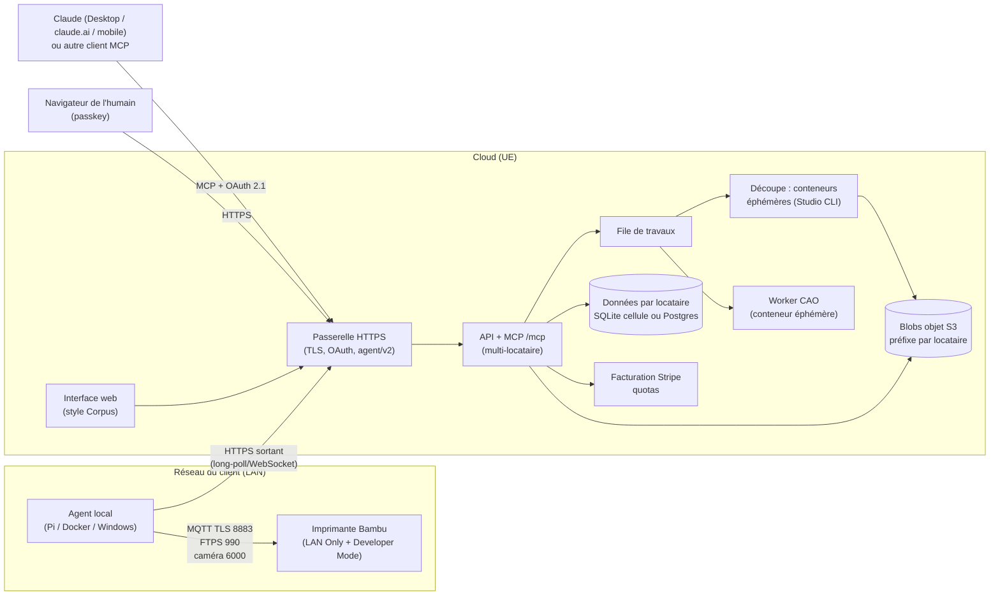

# Plan stratégique et technique : de « Atelier Bambu Lab » à un SaaS hybride vendable

Date : 2026-11-08. Statut : proposition à arbitrer (section 9).
Portée : stratégie, architecture cible, économie, mise sur le marché, feuille de route. Aucun code applicatif n'est modifié par ce document.

**Convention de lecture.** Chaque affirmation est étiquetée :

- **[V]** vérifié dans le dépôt (fichier ou document cité) ;
- **[H]** hypothèse de travail, à tester ;
- **[à vérifier]** fait externe (prix, conditions, licences) que je ne peux pas confirmer ici : à contrôler sur la source officielle avant toute décision ; **[connaissance]** : fait externe dont je suis raisonnablement sûr mais non revérifié aujourd'hui.

---

## 1. Résumé exécutif

1. **Produit.** Un copilote de fabrication pour imprimantes Bambu Lab : bibliothèque de modèles, modèles paramétriques, découpe par Bambu Studio, coûts, journal, et pilotage depuis Claude avec un lancement **toujours approuvé par un humain**. [V] ~67 000 lignes de Go hors tests et ~35 000 de tests (comptage §4.8), 46 outils MCP, 14 migrations SQLite, image Docker tout-en-un, OAuth 2.1 pour connecteur distant déjà écrit.
2. **Le vrai état.** Le serveur tourne en production chez l'utilisateur et pilote une vraie P1S depuis le 8 novembre 2026 (découpe, dépôt, lancement après accord humain, suivi, caméra). Les premiers essais réels ont révélé des défauts (photo figée, heures UTC, carte non affichée dans Claude Desktop, décollement non signalé), corrigés depuis. A1, X1C et un usage long restent à éprouver : c'est la phase P0. [V : essais terrain ; docs/ETAT.md à mettre à jour]
3. **Modèle.** SaaS hybride : un **cloud** (comptes, bibliothèque, découpe, facturation, connecteur MCP distant) + un **agent local** léger (Pi, Docker, Windows) qui seul parle à l'imprimante en connexion **sortante**. Le code d'accès LAN ne quitte jamais le réseau du client.
4. **Avantage défendable.** Pas la gestion de flotte (déjà saturée), mais la combinaison « Claude pilote la fabrication » + « l'humain seul approuve le lancement » + bibliothèque + paramétrique + coûts. Aucun concurrent identifié ne propose le connecteur Claude avec ce modèle de confiance **[H : à confirmer par veille]**.
5. **Cible.** D'abord vendeurs Etsy/MakerWorld et petites fermes (2 à 10 imprimantes) ; makers via un niveau gratuit ; écoles/fablabs via une licence auto-hébergée (le produit actuel, quasi tel quel).
6. **Prix à tester.** Gratuit / Maker 8–12 €/mois / Atelier 29–49 € + 5–10 €/imprimante / licence auto-hébergée annuelle (§5).
7. **Économie.** Le coût marginal est faible : CPU de découpe de l'ordre de quelques centimes par client et par mois, le LLM étant payé par l'abonnement Claude du client **[H, chiffré §5]**. Seuil de rentabilité d'exploitation : de l'ordre de 15 à 25 clients payants. Le coût dominant est le temps de support, pas l'infrastructure.
8. **Risques existentiels.** (a) Bambu Lab ferme ou durcit le mode développeur / LAN ; (b) marque « Bambu » ; (c) incident (incendie) lié à un lancement à distance ; (d) dépendance à Claude/MCP. Parades en §3.
9. **Chemin critique.** P0 fiabiliser sur matériel (3–4 sem.) → P1 nom + UI (3) → P2 agent installable + connecteur distant (6–8) → P3 multi-locataire + Stripe (8–10) → P4 bêta 20 utilisateurs (8) → P5 lancement (4). Total ≈ 8 à 9 mois en solo avec agents de code **[H]**.
10. **Décisions urgentes** (§9) : nom, licence/CLA, statut juridique, choix « cellules SQLite » vs Postgres, et accepter que le cloud ne voie jamais le réseau local du client.

---

## 2. Problème, cible, valeur, concurrence

### 2.1 Problème

Un propriétaire de Bambu Lab accumule des fichiers (STL/3MF/STEP, versions, réglages), perd du temps à préparer chaque plateau, ne sait pas combien coûte une pièce, et veut déléguer la préparation à une IA **sans lui confier le bouton « imprimer »**. Un vendeur Etsy/MakerWorld y ajoute : variantes de produit, coûts réels pour fixer un prix, historique par commande, reprise d'un plateau qui a marché. Une petite ferme y ajoute la file d'attente et la visibilité sur plusieurs machines.

Ce que l'outil actuel fait déjà [V : README, docs/BACKLOG.md] : import non destructif et versions immuables, 17 gabarits paramétriques (worker CAD Python), objectifs de fabrication et variantes comparées sur mesures réelles du slicer, estimation de coût, journal d'impressions, tableau de bord d'usage, bobines/AMS, file d'attente, caméra + détection d'échec (alerte, arrêt humain), notifications (ntfy/webhook/mail), export de projet, import par lien MakerWorld/Printables.

### 2.2 Cibles (ordre de priorité)

| # | Segment | Besoin principal | Pourquoi ils paient | Canal |
|---|---|---|---|---|
| 1 | Vendeurs Etsy / MakerWorld (1–3 imprimantes) | Variantes, coût réel, journal par commande, gain de temps | L'outil se rembourse en une vente | r/BambuLab, Discord, vidéos |
| 1b | Petites fermes (3–15 imprimantes) | File, suivi multi-machines, alertes, traçabilité | Ils paient déjà des outils de ferme | Démarchage direct, communautés de fermes |
| 2 | Makers (1 imprimante) | Ranger, retrouver, « Claude, prépare ça » | Gratuit : porte d'entrée, alimente la bouche-à-oreille | Vidéos, MakerWorld |
| 3 | Écoles, fablabs, makerspaces | Données sur site, pas de compte élève, licence claire | Budget annuel, exigence RGPD/souveraineté | Licence auto-hébergée (AGPL + commerciale) |

### 2.3 Proposition de valeur

« Dites à Claude ce que vous voulez fabriquer. Il range, prépare, découpe, compare, chiffre. **Vous seul** appuyez sur Lancer. » Trois promesses vérifiables : (1) les originaux ne sont jamais modifiés ; (2) aucun outil de l'IA ne peut approuver un lancement ou un arrêt [V : docs/SECURITY.md §1, test `TestCookieWritesNeedCSRFHeaderAndSameOrigin`] ; (3) le code d'accès de l'imprimante reste chez vous.

### 2.4 Concurrence

Les prix sont **à vérifier** sur les sites officiels avant publication. Ma description des fonctions est **[connaissance]** et peut être datée.

| Acteur | Ce qu'il fait | Prix public | Notre écart |
|---|---|---|---|
| Bambu Handy / Bambu Studio / Bambu Cloud / Bambu Farm Manager (Bambu Lab) | Pilotage et suivi natifs, cloud officiel, gestion multi-imprimantes | Gratuit [connaissance] ; à vérifier | Ils ne font ni bibliothèque intelligente, ni coûts, ni pilotage par Claude. **Risque** : Bambu peut intégrer ces fonctions. |
| OctoPrint / Obico | Suivi, plugins, détection d'échec par IA (Obico) ; surtout Marlin/Klipper | OctoPrint gratuit ; Obico auto-hébergé gratuit, cloud payant (à vérifier) | Pas centré Bambu, pas de bibliothèque ni de découpe pilotée. |
| SimplyPrint | Cloud de gestion d'imprimantes et de fermes, file, quotas | Niveaux gratuit / payants (à vérifier) | Gestion de flotte mature ; **ils documentent eux-mêmes le Developer Mode Bambu** [V : docs/research/bambu-lan-protocol.md]. Pas de copilote IA. |
| 3DPrinterOS | Plateforme cloud, découpe cloud, éducation/entreprise | À vérifier | Fort sur l'éducation et la découpe cloud ; offre plus « entreprise ». |
| Printago | Gestion de ferme orientée production/e-commerce | À vérifier | Concurrent le plus proche pour les vendeurs Etsy ; à étudier en détail. |
| AutoFarm3D | Automatisation de ferme | À vérifier | Idem ; à étudier. |
| Bambu Studio « tel quel » + MakerWorld | Découpe et bibliothèque communautaire | Gratuit | Notre concurrent réel est l'**inertie** : « je fais ça à la main ». |

**Différenciation retenue** : (1) connecteur Claude de premier rang (cartes de confirmation dans la conversation) ; (2) sécurité de lancement par construction ; (3) bibliothèque + paramétrique + mesures réelles du slicer + coûts dans un même outil ; (4) option auto-hébergée pour les écoles. **À éviter** : se battre sur la gestion de flotte pure contre SimplyPrint/Printago.

**Tâche de veille (avant P1)** : fiche par concurrent (prix, quotas, support Bambu LAN/cloud, intégration IA/MCP éventuelle), tenue dans un tableur. Sans cela, §5 repose sur des prix non confirmés.

---

## 3. Risques majeurs et parades

| # | Risque | Gravité | Ce que dit le code / les docs | Parade |
|---|---|---|---|---|
| R1 | **Dépendance à Bambu Lab** : firmware « Authorization Control » (2025) bloque le démarrage d'impression par le réseau, la caméra distante, etc., sauf en **LAN Only + Developer Mode** ; Bambu ne supporte pas ces intégrations. | **Critique** | [V : docs/research/bambu-lan-protocol.md §1] Le Developer Mode coupe le Bambu Cloud et Handy pour l'imprimante : le client doit **renoncer** à l'app officielle. Firmwares concernés : P1 ≥ 01.08.02.00, X1 ≥ 01.08.03.00, A1 ≥ 01.05.00.00, H2D ≥ 01.01.00.01. | (1) Dire clairement ce compromis à l'achat ; (2) architecture « adaptateur » : `printer.Adapter` existe [V] pour brancher une voie officielle (Bambu Connect) si elle devient praticable ; (3) mode dégradé « sans lancement » (préparer/découper/déposer, lancer à l'écran) qui garde de la valeur [V : « mode sans carte » en place] ; (4) veille firmware à chaque version (matrice de compatibilité publique) ; (5) contact officiel avec Bambu (programme partenaire / dev relations) **avant** le lancement. |
| R2 | **CGU / API Bambu** : MQTT/FTPS LAN non documentés officiellement comme API produit ; MakerWorld interdit-il l'import automatisé ? | Haut | [V] Import par lien MakerWorld/Printables en place (backlog #11). [à vérifier] CGU MakerWorld sur le scraping/téléchargement automatisé. | Lecture juridique des CGU Bambu/MakerWorld ; limiter l'import à ce que l'utilisateur ferait à la main (fichier public, usage personnel) ; ne jamais redistribuer les modèles ; licence des modèles affichée. |
| R3 | **Marque « Bambu »** : « Atelier Bambu Lab » et « bambu-mcp » reprennent la marque. Risque de mise en demeure, de retrait du nom de domaine. | Haut | [V] Le nom est partout (module Go `BAMBULAB-MCP`, binaires, README). | Renommer (P1), n'utiliser « Bambu Lab » qu'en **mention descriptive** (« compatible avec les imprimantes Bambu Lab »), mention de non-affiliation, jamais dans le nom, le domaine, le logo. Dépôt INPI/EUIPO du nouveau nom (§8). |
| R4 | **AGPL de Bambu Studio exécuté côté serveur** | Haut (juridique) | [V] Studio est lancé comme **programme externe** non modifié, jamais inclus dans le dépôt ; l'image Docker le télécharge au build avec SHA-256 [V : Dockerfile, README §Licence]. | Ne **jamais modifier** Studio ; conserver le sous-processus (pas de lien) ; fournir la source/le lien officiel et la notice de licence dans l'image et le site ; avis d'un avocat sur « exécution côté serveur d'un AGPL non modifié, hébergé pour des tiers » (l'obligation de l'art. 13 vise les versions **modifiées** [connaissance], mais l'image redistribuée contient Studio : l'offre de source est requise) ; alternative de repli : découpe sur l'agent du client (déjà prévue dans le protocole, §4.3). **À valider par un juriste.** |
| R5 | **Responsabilité : incendie / dommage** lié à un lancement à distance | **Critique** | [V] Garde-fous : accord humain lié à l'impression, case « plateau vide », scan thermique du G-code, jamais de renvoi, détection d'échec avec **arrêt humain** [docs/SECURITY.md §3, §11, backlog]. Mais **aucun** garde-fou ne remplace une surveillance physique. | CGU : usage sous surveillance raisonnable, pas de garantie ; plafond de responsabilité ; recommandation détecteur de fumée ; mode « présence » optionnel (lancement refusé si l'agent n'a pas vu l'imprimante idle ni de photo du plateau) ; assurance RC Pro + cyber **[à vérifier : prime, exclusions IoT/incendie]** ; journal d'audit conservé comme preuve du consentement. |
| R6 | **RGPD / données** | Moyen | [V] Données actuelles : fichiers, journal d'impressions, photos de plateau, caméra. Aucun compte multi-utilisateur n'existe aujourd'hui. | Hébergement UE, registre des traitements, DPA (accord de sous-traitance) pour les clients pro, durées de conservation, effacement vérifiable, photos/caméra : stockage minimal et chiffré, jamais de flux vidéo continu dans le cloud (§4.4). |
| R7 | **Dépendance à Claude / MCP** | Haut | [V] Le serveur MCP est un cœur unique (stdio + Streamable HTTP) ; l'UI web et l'API HTTP couvrent les mêmes fonctions ; `internal/mcpserver/clientcaps.go` détecte les capacités du client. Les vues MCP App sont « à éprouver dans un vrai Claude Desktop » [V : backlog]. L'affichage dans claude.ai et mobile n'est **pas vérifié**. | Le produit doit rester **complet sans Claude** (interface web = citoyen de première classe) ; MCP = un client parmi d'autres (ChatGPT, Gemini, Cursor, clients open source : la spec est ouverte) ; repli texte/image + lien `/confirm` si la vue ne s'affiche pas [V : mode dégradé]. Les coûts LLM sont portés par l'utilisateur, donc pas de dépendance de marge. |
| R8 | **Code de lancement faible** | Moyen | [V] Code à 6 chiffres haché, 3 essais, 2 min ; le risque résiduel « code tapé dans la conversation » est documenté (SECURITY §12). Un code à 6 chiffres **haché** est trivial à retrouver hors ligne si la base fuit. | Multi-locataire : remplacer par **WebAuthn/passkey** (déjà listé « reste ouvert » au backlog) ou, à défaut, KDF lent + secret serveur + verrou ; jamais de code stocké côté agent (§4.6). |
| R9 | **Sécurité du cloud** : fichiers 3MF/STEP de tiers parsés par Studio et CadQuery (surface d'attaque, DoS) | Haut | [V] Garde-fous partiels : tailles max, signatures vérifiées, liste blanche de surcharges, délai de 10 min par découpe, `Setpgid`. Pas d'isolation forte. | Un conteneur éphémère **sans réseau**, CPU/mémoire plafonnés, par découpe ou import ; quotas ; test de fuzzing sur les parseurs (`internal/mesh`). |
| R10 | **Support et dette** : un seul développeur, matériel hétérogène (P1S, A1, X1, H2D…) | Haut | [V] Une seule machine de référence (P1S). | Matrice de compatibilité honnête (« testé / non testé ») ; déclarer la P1S, l'A1 et la X1C au lancement ; les autres en « expérimental ». |

---

## 4. Architecture cible

### 4.1 Principe

Le cloud ne se connecte **jamais** au réseau du client. L'agent initie toutes les connexions (HTTPS sortant, long-poll ou WebSocket). Tout ce qui nécessite d'atteindre l'imprimante (MQTT TLS 8883, FTPS implicite 990, caméra TCP 6000) se fait dans l'agent. Tout ce qui est calcul lourd ou état partagé (bibliothèque, découpe, coûts, comptes) est dans le cloud.



Même schéma en ASCII, pour les éditeurs sans mermaid :

```
 Claude / autre client MCP ──MCP+OAuth──┐
 Navigateur (passkey) ──HTTPS───────────┤        CLOUD (UE)
                                        ▼   ┌───────────────────────────────┐
 RÉSEAU CLIENT                     Passerelle│ API + MCP (multi-locataire)   │
 ┌──────────────────┐   HTTPS      HTTPS    │  ├ file de travaux            │
 │ Agent local      │──sortant────▶ agent/v2 │  ├ découpe : conteneurs Studio│
 │ Pi/Docker/Win    │               ▲        │  ├ worker CAO (conteneur)     │
 └───────┬──────────┘               │        │  ├ données par locataire      │
   MQTT 8883 / FTPS 990 / cam 6000  │        │  ├ blobs S3 (préfixe locat.)  │
         ▼                          │        │  └ Stripe, quotas             │
   Imprimante Bambu                 └────────┴───────────────────────────────┘
```

### 4.2 Ce qui existe aujourd'hui (vérifié)

- **bambud** : un seul binaire Go, **mono-locataire**, SQLite pur Go (14 migrations, `internal/store/migrations`), blobs adressés par contenu `data/blobs/ab/cd/<sha256>`, file de travaux persistante (1 lourd + 4 légers par défaut), MCP Streamable HTTP + stdio, pages humaines HTML (`/confirm`, `/stop`, `/enroll`, `/setup`). [V : ARCHITECTURE.md, DEPLOY-LINUX.md]
- **Le lien imprimante est dans bambud, pas dans l'agent.** `internal/printer` (MQTT paho, FTPS, caméra) et `internal/printing` (chaîne d'impression, démarrage auto à l'approbation) tournent sur le serveur. [V]
- **bambu-agent est un renfort Windows**, pas un relais d'imprimante : inventaire/envoi de dossiers, découpe locale, lecture/ouverture dans Studio. Types de travaux : `inventory`, `upload_files`, `slice`, `get_project_state`, `open_in_studio`. [V : internal/agentlink/protocol.go]
- **Le protocole `/agent/v1` interdit à l'agent les travaux physiques** (`PhysicalKinds` : `start_print`, `send_to_printer`). [V] C'est une décision de sécurité excellente en mono-site ; elle doit être **renversée avec précaution** dans l'hybride (§4.6), puisque l'imprimante n'est plus joignable que par l'agent.
- **Le protocole agent est déjà « sortant »** : `GET /agent/v1/tasks/next` avec attente (long-poll), `hello`, `heartbeat`, `progress`, `result`, `inventory`, `uploads/begin`, `PUT uploads/{sha}`, `GET blobs/{sha}` ; appairage par jeton à usage unique, secret d'agent haché côté serveur, épinglage de certificat optionnel (`--server-fingerprint`), reprise de transfert, états `queued/assigned/running/succeeded/failed/cancelled/unknown`. [V : client.go, server.go, SECURITY §6]
- **OAuth 2.1 pour connecteur Claude déjà implémenté** : métadonnées RFC 9728/8414, DCR RFC 7591, PKCE S256, refresh rotatif avec révocation au rejeu, consentement humain obligatoire. Redirection `https://claude.ai/api/mcp/auth_callback`. [V : docs/OAUTH.md ; tests `internal/httpapi/oauth_test.go`]
- **Windows : DPAPI** pour le coffre de l'agent. [V : `internal/agent/dpapi_windows.go`]

### 4.3 Découpe cloud / agent

| Fonction | Où | Pourquoi |
|---|---|---|
| Comptes, quotas, facturation, OAuth/MCP, interface web | Cloud | Cœur du service |
| Bibliothèque (catalogue, versions, doublons, corbeille), aperçus GLB, analyse maillage | Cloud | Calcul léger, partagé entre appareils |
| Paramétrique (CadQuery), import STEP | Cloud, conteneur éphémère | Dépendance lourde (OCP) |
| **Découpe Bambu Studio** | **Cloud par défaut** ; **agent en option** (x86_64 avec Studio installé) | Le client n'a pas à installer Studio ; Studio n'est pas disponible sur Pi ARM **[H : à vérifier, binaire officiel surtout x86_64]**. Le protocole sait déjà déléguer `slice` à l'agent. |
| Coûts, journal, tableaux de bord, objectifs/variantes | Cloud | Données du client |
| **Lien imprimante** : MQTT (état, commandes), FTPS (dépôt), caméra | **Agent** | Joignable seulement depuis le LAN |
| **Code d'accès LAN de l'imprimante** | **Agent uniquement** (chiffré localement) | Ne jamais l'envoyer au cloud : réduit l'exposition RGPD et la responsabilité |
| Détection d'échec par la caméra | Agent (image locale) → alerte cloud | Évite de remonter la vidéo ; seuls événements et vignettes |
| Photo du plateau pour `/confirm` | Agent → cloud sur demande, durée de vie courte | Nécessaire à la validation humaine |

### 4.4 Protocole agent ↔ cloud (`/agent/v2`)

**Réutilisable tel quel** : appairage, secret haché, long-poll de tâches, heartbeat, transferts par blobs vérifiés par sha256 avec reprise, états de tâche, épinglage. **Extension proposée** (types de travaux nouveaux, version majeure 2 car les travaux physiques changent de règle) :

| Nouveau type | Direction | Contenu |
|---|---|---|
| `printer_link` (config) | cloud → agent | Liste d'imprimantes à gérer (IP, série) **sans** code d'accès : celui-ci est saisi **sur l'agent** (page locale ou CLI) |
| `telemetry` (flux) | agent → cloud | États MQTT normalisés (déjà un modèle `status.go`), AMS, progression, HMS/erreurs ; débit borné (agrégation à 1 Hz maxi, 5 s en veille) |
| `upload_to_printer` | cloud → agent | Référence de blob sha256 ; l'agent télécharge puis FTPS vers l'imprimante |
| `start_print` | cloud → agent | **Uniquement** avec une autorisation signée (§4.6) |
| `stop_print` | cloud → agent | Idem |
| `camera_snapshot` | cloud → agent | Image ponctuelle (JPEG), TTL court, jamais de flux continu par défaut |
| `discover` | cloud → agent | Recherche des imprimantes sur le LAN **[H : mécanisme de découverte Bambu (SSDP) à vérifier]** ; saisie manuelle de l'IP en repli |

Choix de transport : conserver HTTPS long-poll (fonctionne derrière tout NAT/proxy d'entreprise ou d'école) ; envisager WebSocket pour la télémétrie seulement si le coût par requête devient gênant **[H]**. Versionnage : l'ancien v1 reste pour l'auto-hébergé.

**Appairage** : remplacer « jeton collé » par un **flux d'appareil** (l'agent affiche un code court, l'utilisateur le saisit sur le site connecté) : l'équivalent existe déjà (page `/agents/pair` + jeton 15 min haché) ; il faut juste lier l'agent à un **locataire** au lieu d'une instance.

### 4.5 Multi-locataire

**Constat [V]** : aucune notion de locataire dans le code (les migrations n'en portent pas ; l'identité actuelle = « un humain devant un navigateur enregistré » + un Bearer global). Tout le modèle d'identité est à réécrire ; le reste du domaine peut rester presque intact si l'on isole par base.

**Options**

| | A. Une base SQLite par locataire (« cellule ») | B. Postgres partagé, `tenant_id` partout + RLS |
|---|---|---|
| Effort | Faible : le code existant tourne quasi tel quel derrière un routeur | Élevé : réécrire `internal/store`, `catalog`, `library`, `printing`, `insights`, `jobs`… (~25 000 à 40 000 lignes touchées, estimation) |
| Isolation | Très forte (fichier distinct) | Bonne si RLS rigoureuse ; risque de fuite par oubli |
| Échelle | Jusqu'à quelques centaines/milliers de locataires par nœud ; sauvegarde fichier par fichier | Milliers à millions |
| Requêtes inter-locataires (stats produit) | Pénibles | Faciles |
| Coût opérationnel | Gestion de N fichiers, migrations en parallèle | Un seul moteur |

**Recommandation** : **A pour P3–P5** (livrer vite, isolation forte, réutilise 90 % du code), avec un `TenantRouter` qui ouvre la base du locataire et un identifiant de locataire dans chaque contexte ; **migrer vers B seulement si** on dépasse ~500 locataires actifs ou si un besoin analytique l'impose **[H]**. Décision à prendre en §9.

**Blobs** : stockage S3-compatible (UE), préfixe par locataire. **Pas de dédoublonnage inter-locataires** (un hash connu permettrait de sonder l'existence d'un fichier chez autrui). Les URL de téléchargement/aperçu restent **signées et expirantes** (déjà le cas : HMAC + expiration [V]).

**Files de découpe** : la file persistante existe (classes lourd/léger) mais est **par instance**. Cloud : une file globale avec **équité entre locataires** (tourniquet pondéré par offre), limite d'un travail lourd simultané par locataire gratuit, délai max de 10 min déjà présent [V]. Exécution en **conteneur éphémère** (pas de réseau, lecture seule hors dossier de travail, CPU 2, RAM plafonnée), à la demande ; pool chaud de 1–2 conteneurs pour la latence. `HOME` et `$TMPDIR` de Studio isolés par job (Studio écrit dans `~/.config/BambuStudio` et `bamboo_model` [V : DEPLOY-LINUX §7]).

**Coût CPU d'une découpe** : mesuré [V] : un cube sur P1S, 100 couches, **577 ms** de Studio, pic ≈ 95 Mio (plancher d'échantillonnage). Une vraie pièce multi-plateaux sera nettement plus longue : **[H] 20 à 180 s** sur 2 vCPU, 0,3 à 1,5 Gio de RAM ; à **mesurer en P0** sur un lot de 20 pièces réelles. Import STEP : délai plafond 10 min [V]. Analyse 1 M triangles : 4,4 s, ≈ 490 Mio de tas [V].

**Identité** : comptes e-mail + passkey (WebAuthn) ; organisation (locataire) avec rôles (propriétaire, membre, lecteur) ; jetons d'accès OAuth liés à `(utilisateur, locataire)`. Le serveur d'autorisation de `internal/oauth` est réutilisable ; le **consentement** n'est plus conditionné au cookie « navigateur enregistré » mais à la session du compte. Un seul URL de connecteur pour tous (`https://<nom>/mcp`), le locataire se déduit du jeton.

### 4.6 Sécurité du lancement à distance

Situation actuelle [V] : l'accord est lié à (imprimante, empreinte du fichier, plateau, matières), à usage unique, expire (10 min) ; le serveur lance lui-même l'impression à l'approbation, **une seule fois, sans renvoi** ; un `START_UNKNOWN` est réconcilié en lecture. Les travaux physiques sont refusés à l'agent.

Dans l'hybride, le serveur n'atteint plus l'imprimante : c'est l'agent qui exécute. Le risque nouveau : un cloud compromis (ou un bug multi-locataire) ordonnerait un lancement à tous les agents. Conception proposée :

1. **Autorisation signée** : à l'approbation humaine, le cloud signe (Ed25519) une charge `{locataire, imprimante, sha256 du .gcode.3mf, plateau, matières, nonce, expiration ≤ 2 min, empreinte du navigateur/passkey approbateur}`. La clé de **vérification** est épinglée à l'appairage de l'agent ; la clé de signature est dans un KMS/HSM, journalisée.
2. **L'agent revérifie** : signature, expiration, nonce jamais vu, sha256 du fichier qu'il a lui-même téléchargé **et** relu, état de l'imprimante (idle, plateau OK selon la dernière photo), puis envoie **une seule fois** la commande ; en cas d'accusé manquant, état `unknown`, **jamais de renvoi** (même règle qu'aujourd'hui).
3. **Approbation humaine forte** : passkey/WebAuthn dans la vue de confirmation (remplace le code à 6 chiffres, R8). La vue MCP App peut afficher la demande, mais l'**approbation** passe par un appel WebAuthn qui n'est pas dans le canal du modèle. Le lien `/confirm` dans le navigateur reste le repli.
4. **Options pour les clients exigeants** : confirmation **locale** sur l'agent (bouton sur l'appli barre des tâches ou page locale) ; fenêtre horaire (« lancements autorisés 8 h–22 h ») ; refus si dernière télémétrie > 30 s ; limite d'un lancement par imprimante par durée minimale ; liste d'imprimantes « lancement à distance désactivé ».
5. **Disjoncteur** : un indicateur global côté cloud (kill-switch) + un indicateur local (fichier/interrupteur sur l'agent) qui refuse tout `start_print`. Journal d'audit signé, en lecture seule pour le client (preuve en cas d'incident).
6. **Isolation** : un agent n'accepte que les tâches de son locataire ; token agent ≠ token utilisateur ; rotation du secret d'agent.

Ce que le modèle (Claude) ne peut toujours **pas** faire : approuver. C'est la propriété produit centrale à conserver et à tester en continu (tests de non-régression de `docs/SECURITY.md` §1).

### 4.7 Connecteur MCP distant et vues dans Claude

- **Acquis [V]** : serveur MCP Streamable HTTP, OAuth 2.1 conforme aux exigences de Claude lues le 2026-11-07, métadonnées d'app (`ui://`, `text/html;profile=mcp-app`, `_meta.ui.resourceUri`, CSP) ; vues : confirmation/arrêt, plateau, etc. ; bundle de vue ≈ 1 Mo (`resources/read` : 1 047 815 caractères [V : docs/research/mcp-apps.md §7]) ; `clientcaps.go` pour détecter ce que le client sait afficher.
- **Non acquis** : affichage des vues dans **claude.ai et mobile** ; même Claude Desktop est « à éprouver » [V : backlog]. **Aucune promesse commerciale tant que P2 n'a pas prouvé l'affichage sur chaque surface.**
- **Plan** : (1) matrice « surface × fonction » (Desktop, claude.ai, iOS/Android) testée en P2 ; (2) toujours un repli texte + image + lien ; (3) alléger le bundle (≈ 1 Mo est lourd pour mobile) **[H]** ; (4) tenir la liste de clients MCP alternatifs testés.

### 4.8 Réutilisable tel quel / à adapter / à réécrire, par paquet `internal/`

Les tailles sont les lignes Go **hors tests** (fichiers à la racine de chaque paquet, comptées le 2026-11-08). « Réutilisable » = vrai pour le cœur de la logique, indépendamment du multi-locataire (que le routage par base de la solution A absorbe en grande partie).

| Paquet | Lignes | Verdict | Commentaire |
|---|---:|---|---|
| `contracts` | 907 | Réutiliser | Types, schémas, machine d'états d'impression (fonction pure). Ajouter l'autorisation signée. |
| `store` | 976 | **Adapter** | SQLite + blobs : ajouter `TenantRouter`, blobs sur S3 (interface existe de fait par `blobs.go`), chiffrement au repos. |
| `catalog` | 6 625 | Réutiliser | Bibliothèque, versions, doublons, corbeille, dérivés ; tourne par locataire. Import STEP vers conteneur. |
| `library` | 1 173 | Réutiliser | Règles de bibliothèque. |
| `mesh` | 4 801 | Réutiliser | Maillage pur Go ; **cibler en fuzzing** (parseurs de fichiers tiers). |
| `engineering` | 1 528 | Réutiliser | Fonctions pures (tolérances, contraintes) avec niveau mesuré/calculé. Vérifier la redistribution des données matériaux (fiches techniques). |
| `export` | 2 118 | Réutiliser | Archives zip en flux, URL signées. |
| `goals` | 3 886 | Réutiliser | Objectifs, variantes, comparaison. |
| `calibration`, `filament`, `insights`, `localtime`, `notify` | 1 363 / 2 806 / 3 294 / 104 / 1 519 | Réutiliser | `notify` : durcir l'anti-SSRF (`netguard.go` existe [V]) pour des webhooks de locataires. |
| `profiles` | 1 763 | Adapter | Lit les profils **du Studio installé** : en cloud, une version de Studio figée par image ; versionner les profils. |
| `slicer` | 3 977 | **Adapter** | Sous-processus Studio avec liste blanche de surcharges, interdiction des `*_gcode`, scan thermique [V] : garder tel quel ; exécuter dans un conteneur éphémère ; une seule version de Studio épinglée. |
| `jobs` | 1 009 | **Adapter** | File persistante par instance ; il faut équité inter-locataires, quotas, exécuteurs éphémères. |
| `printing` | 8 643 | **Scinder** | Une partie (préparation, découpe, confirmation, coût) reste cloud ; une partie (dépôt, démarrage, réconciliation) **passe dans l'agent**. Plus gros chantier technique. |
| `printer` | 2 008 | **Déplacer vers l'agent** | MQTT/FTPS/caméra, simulateur : tel quel, mais exécuté chez le client. Go pur : compile pour Pi/Windows/Linux. |
| `camera` | 1 969 | **Scinder** | Détection d'échec dans l'agent ; réglages et alertes côté cloud. |
| `agent` | 1 892 | Réutiliser + étendre | Windows seulement aujourd'hui (DPAPI, Studio) : ajouter Linux/ARM/Docker (fichier `dpapi_other.go` existe, mais le coffre non Windows est à vérifier [H]) ; appli barre des tâches = **nouveau**. |
| `agentlink` | 2 963 | **Étendre en v2** | Cf. §4.4. Les tests de `agentlinktest` servent de base de non-régression. |
| `humanauth` | 1 082 | **Réécrire** | Navigateurs enregistrés par code CLI → comptes + passkey ; le code de lancement devient WebAuthn. Les **principes** de `docs/SECURITY.md` §2 (CSRF, Sec-Fetch, nonce, pas de route d'approbation dans l'API/MCP) sont à conserver. |
| `oauth` | 796 | Adapter | Garder le serveur ; changer le consentement (session de compte) et lier les jetons à un locataire. |
| `httpapi` | 2 625 | Adapter | Garde Host, CSRF, proxy de confiance conservés ; ajouter locataire, quotas, limitation de débit par compte. |
| `mcpserver` | 3 669 | Adapter | Outils : ajouter le contexte locataire et les quotas ; surface MCP à surveiller (46 outils [V], trop pour certains clients : prévoir des profils d'outils). |
| `backup` | 866 | Adapter | Sauvegarde d'une base → sauvegarde par cellule vers S3 ; restauration par locataire. |
| `core`, `webui` | 754 / 118 | Adapter | Câblage ; SPA embarquée → refonte « Corpus » (P1). |
| `cmd/printer-sim` | — | Réutiliser | Banc d'essai de l'agent et de la CI ; **ne remplace pas** la vraie machine. |

**Dépôt entier** : environ 67 000 lignes Go hors tests et 35 000 lignes de tests (paquets `internal/*` et `cmd/*`, fichiers à la racine de chaque paquet ; sous-dossiers non comptés), soit un code de taille modeste et réécrivable en partie ; `docs/ETAT.md` annonçait 370 fonctions de test au jalon 9 (chiffre ancien).

---

## 5. Modèle économique

### 5.1 Offres (à tester, pas à graver)

| Offre | Prix visé | Imprimantes | Découpes / mois | Stockage | Cible | Notes |
|---|---|---:|---:|---:|---|---|
| **Gratuit** | 0 € | 1 | 20 | 1 Go | Makers | Pas de lancement distant (ou file d'attente limitée) ; l'objectif est la découverte et le bouche-à-oreille |
| **Maker** | 8–12 €/mois (ex. 9 €) | 2 | 200 | 20 Go | Vendeurs Etsy/MakerWorld | Lancement distant, journal, coûts, export, notifications |
| **Atelier** | 29–49 €/mois + 5–10 €/imprimante au-delà de 3 | 3 incl. | 1 000 | 100 Go | Petites fermes | File d'attente, rôles, plusieurs membres, support prioritaire |
| **Licence auto-hébergée** | À fixer : ex. 300–1 500 €/an selon site | illimité | — | — | Écoles, fablabs, ateliers | Le produit actuel (`bambud`) sans cloud ; AGPL gratuite pour qui accepte ses conditions ; licence **commerciale** pour qui ne le peut pas (§8) |

**Pourquoi quotas de découpes plutôt que de CPU** : c'est la seule ressource qui coûte vraiment (et la plus facile à expliquer). Stockage et nombre d'imprimantes sont des garde-fous de coût de support.

**Ce que l'utilisateur paie en plus, sans que nous le facturions** : son abonnement Claude. C'est un argument de marge, mais aussi un **frein commercial** (cible = abonnés Claude payants, pas tous les makers). **[H]** à tester dès P0 par entretiens : quelle part de la cible utilise déjà Claude ? L'interface web comme client complet (sans IA) atténue ce frein ; une aide IA intégrée serait un coût LLM à notre charge **[H : décision à prendre, §9]**.

### 5.2 Coût de revient par client (hypothèses explicites)

Toutes les valeurs externes sont **[H] à vérifier** avec des devis réels.

| Poste | Hypothèse | Calcul | Par client/mois |
|---|---|---|---:|
| CPU de découpe | 90 vCPU-s par découpe (≈ 45 s sur 2 vCPU), vCPU ≈ 2,4 × 10⁻⁶ €/s (serveur 4 vCPU à ~25 €/mois facturé en continu) | Maker : 200 × 90 × 2,4e-6 | ≈ 0,04 € |
| CPU de découpe, usage max | Atelier 1 000 découpes | 1 000 × 90 × 2,4e-6 | ≈ 0,22 € |
| Capacité réservée (pic) | La CPU facturée au pic, pas à la moyenne : prévoir 2 à 4 nœuds en réserve | ~50–100 € fixes dès le lancement | voir 5.3 |
| Stockage objet | 0,01 €/Go/mois (S3 compatible UE) | Maker 20 Go : 0,20 € ; Atelier 100 Go : 1 € | 0,2 à 1 € |
| Sorties réseau | Téléchargements, aperçus | 1–3 Go/mois | < 0,2 € |
| Caméra | **Aucun flux** vers le cloud ; vignettes d'événement + photo de confirmation (≈ 200 Ko × quelques dizaines) | négligeable | < 0,05 € |
| Télémétrie | 1 message/5 s par imprimante en impression ≈ 17 000/jour max | négligeable en stockage si agrégé | < 0,1 € |
| Paiement | Stripe, cartes UE ≈ 1,5 % + 0,25 € **[à vérifier]** | Maker 9 € : 0,39 € ; Atelier 39 € : 0,84 € | 0,4 à 0,9 € |
| TVA / facturation | Outil de TVA (Stripe Tax ou équivalent) **[à vérifier]** | ~0,5 % du CA | ≈ 0,05 € |
| E-mails, journaux, sauvegardes | Bases par cellule + sauvegarde S3 | | ≈ 0,1 € |
| **Support** | **Le vrai coût** : 1 h de support par client Maker et par trimestre à 40 €/h | | ≈ 3 € (!) |

**Marge brute hors support** : Maker 9 € → coûts d'infra + paiement ≈ 0,9–1,2 € → marge ≈ 87 % ; Atelier 39 € + 2 imprimantes supplémentaires à 7 € = 53 € → coûts ≈ 3 € → ≈ 94 %. **Avec support comptabilisé** : Maker ≈ 55–65 %, Atelier ≈ 75–85 %. La rentabilité se joue sur la **réduction du support** (installation en 5 minutes, diagnostics intégrés).

**Niveau gratuit** : coût estimé 0,1–0,3 €/mois par utilisateur actif (quelques Go + 20 découpes + support nul/communautaire). À 1 000 gratuits : 100–300 €/mois ; à encadrer par des quotas stricts et une purge d'inactifs (12 mois).

### 5.3 Point mort

Charges fixes de départ **[H]** : 2 serveurs de découpe + 1 nœud applicatif + stockage + sauvegarde + domaine/e-mail + supervision : **120–250 €/mois** ; assurance : 30–70 €/mois ; comptable : 60–120 €/mois ; outils : 50 €/mois. Total **≈ 260–490 €/mois**. Avec une marge nette ≈ 8 €/client Maker : **≈ 35–60 clients Maker** pour couvrir les fixes, ou ≈ 8–12 clients Atelier. **Hypothèse centrale** (15 Atelier + 60 Maker + écoles) → 1 000–1 500 € de MRR en fin de bêta+1 : plausible, **pas prouvé**.

### 5.4 Licence auto-hébergée

Le produit actuel est déjà installable (`deploy/linux/install.sh`, Docker `docs/QUICKSTART.md`, sauvegarde/restauration) [V]. Valeur de la licence commerciale : (a) usage sans contraintes AGPL (intégrateurs, éditeurs qui veulent embarquer) ; (b) support, mises à jour signées, SLA. **Prudence** : les écoles préfèreront l'AGPL gratuite ; la vente se fait sur le **support + conformité + formation**, pas sur le code seul.

---

## 6. Mise sur le marché

### 6.1 Nom et positionnement

- **Renommer** (R3). Critères : sans « Bambu », prononçable en français et en anglais, `.com`/`.app`/`.fr` disponibles, marque INPI/EUIPO libre dans les classes 9, 42, 35.
- Pistes de travail (**aucune n'a été vérifiée en disponibilité**) : *Plateau*, *Couche*, *Calque*, *Bobine*, *Fil d'atelier*, *Forgeron*. Ne retenir qu'après recherche d'antériorité.
- **Slogan de travail** : « Vous fabriquez. Claude prépare. Vous lancez. »
- **Mentions** : « Compatible avec les imprimantes Bambu Lab. Produit indépendant, non affilié à Bambu Lab. » Jamais le logo Bambu.

### 6.2 Canaux

| Canal | Action | Mesure de succès |
|---|---|---|
| r/BambuLab, r/3Dprinting | Posts utiles (pas de pub) : « j'ai fait préparer 3 variantes par Claude », avec coûts mesurés | Inscriptions liste d'attente |
| Discords (Bambu, MakerWorld, 3D print FR) | Participation, retours, bêta | 20 bêta-testeurs |
| Créateurs MakerWorld | Offrir un compte Atelier à 10 créateurs contre un retour public | 3 vidéos / posts |
| **Vidéos démonstratives** (ex. « porte-guitare Liquid Chrome » : idée → modèle → découpe → coût → impression, sans toucher à Bambu Studio) | 3 vidéos de 2–4 min, sous-titrées FR/EN | Vues → inscriptions ; taux inscription/vue |
| Écoles / fablabs | Démarchage direct de 20 structures avec la licence auto-hébergée + une journée d'installation | 3 pilotes |
| SEO | Pages « comment calculer le coût d'une impression », « retrouver un STL » | Trafic organique |

Les présentations PDF/HTML déjà présentes dans `docs/presentation/` (non suivies par git pour l'instant) servent de matière première.

### 6.3 Page d'attente

Page unique : promesse en 1 ligne, une vidéo de 60 s, 3 bénéfices, un formulaire (e-mail, imprimante(s) possédée(s), usage : Etsy/ferme/maker/école, « utilisez-vous Claude ? ») ; consentement RGPD, double opt-in. **Objectif** : 300 inscrits avant la bêta, dont ≥ 30 % Etsy/ferme.

### 6.4 Bêta fermée, 20 utilisateurs

Composition cible : 8 vendeurs Etsy/MakerWorld, 4 petites fermes, 4 makers avancés, 2 écoles/fablabs, 2 hostiles (sceptiques). Matériel : P1S, A1, X1C obligatoires. Contrat de bêta : gratuit 3 mois, retours hebdomadaires, journal de bord (impressions lancées via l'outil), consentement à la télémétrie produit.

### 6.5 Métriques

| Métrique | Définition | Cible bêta [H] |
|---|---|---|
| Activation | Inscrit → agent appairé → 1re impression **lancée via l'outil** en < 7 jours | ≥ 50 % |
| Temps d'installation | De la création du compte à la première télémétrie | ≤ 5 min médiane |
| Impressions réussies | Impressions lancées avec statut `FINISH` / impressions lancées | ≥ 90 % (même niveau que la machine seule ; à comparer) |
| Rétention | Utilisateurs actifs semaine 4 / actifs semaine 1 | ≥ 40 % |
| Incidents | Lancements non souhaités, `START_UNKNOWN`, échecs de dépôt | 0 lancement non souhaité ; `START_UNKNOWN` < 1 % |
| NPS / interviews | | ≥ 30 |
| Conversion payante (post-bêta) | Gratuit → Maker | ≥ 3 % |

---

## 7. Feuille de route

Les durées supposent **un seul humain décideur et des agents de code**, avec validation par l'orchestrateur ; **[H]**. Ajouter 30 % de marge pour les imprévus matériels.

| Phase | Durée | Critère de sortie |
|---|---|---|
| P0 Fiabiliser sur matériel | 3–4 sem. | 10 impressions réelles bout en bout sur chacune de P1S, A1, X1C sans incident, 0 renvoi de commande |
| P1 Nom + refonte UI « Corpus » | 3 sem. | Nom retenu et vérifié ; UI « Corpus » sur les 6 parcours principaux ; renommage du dépôt/binaires |
| P2 Agent installable en 5 min + connecteur distant | 6–8 sem. | Agent installé par 5 testeurs externes en ≤ 5 min ; connecteur affiché dans claude.ai et mobile (ou limite documentée) |
| P3 Cloud multi-locataire + Stripe | 8–10 sem. | 2 locataires isolés vérifiés par tests d'intrusion maison ; paiement de bout en bout ; quotas appliqués |
| P4 Bêta fermée | 8 sem. | 20 utilisateurs, métriques §6.5 atteintes, 0 incident de sécurité |
| P5 Lancement | 4 sem. | Page publique, CGV/CGU, assurance, support, 3 vidéos, 100 inscrits |

### P0. Fiabiliser sur P1S / A1 / X1

- **Livrables** : exécution de la procédure `docs/BRANCHEMENT.md` sur la P1S ; constater l'URL de `project_file`, le `md5`, la mise à niveau du lit, la forme réelle de `hms`/`print_error`, le dossier SD après FTPS (points listés ouverts [V : bambu-lan-protocol.md §« questions »]) ; mêmes essais sur A1 et X1C ; mesure du temps et de la mémoire de 20 découpes réelles ; premier rapport de compatibilité ; test sur Linux réel avec Studio AppImage headless (**non fait** [V : ETAT §1]) ; tests de non-régression sécurité dans la CI.
- **Risques** : le protocole réel diffère du simulateur (déjà constaté sur P1S lors des premiers essais réels) ; firmware qui change ; A1 et X1C pas disponibles pour l'utilisateur → à emprunter ou à louer.
- **Sortie** : voir tableau ; sans elle, **ne pas poursuivre**.

### P1. Nom + refonte UI

- **Livrables** : liste de noms vérifiés ; dépôt, module Go et binaires renommés (chantier mécanique mais large, `github.com/ArseneGA/BAMBULAB-MCP` dans toutes les importations) ; interface « Corpus » (maquette en cours) ; vues MCP App cohérentes ; **mentions de non-affiliation** ; décision licence/CLA.
- **Risques** : renommage qui casse les liaisons `mcp-remote`/Claude Desktop existantes (migration documentée) ; dérive de périmètre de l'UI.
- **Dépendance** : le choix de nom conditionne domaine, marque, page d'attente.

### P2. Agent local installable en 5 min + connecteur distant

- **Livrables** : protocole `/agent/v2` (§4.4) ; `printer` et chaîne de dépôt/démarrage déplacés dans l'agent ; autorisation signée de lancement (§4.6) ; installeurs : Docker (`docker run`), paquet Linux/Raspberry Pi (arm64), Windows (service existant + appli barre des tâches) ; découverte/saisie d'IP ; flux d'appairage par code d'appareil ; page de santé locale (« je vois l'imprimante : oui/non, firmware, mode développeur ») ; connecteur distant sur une **instance unique de démonstration** (pas encore multi-locataire) ; matrice d'affichage des vues par surface.
- **Risques** : NAT/pare-feu d'école ; mises à jour de l'agent (auto-mise à jour signée) ; coffre du code d'accès hors Windows ; Studio indisponible sur ARM (la découpe reste cloud) ; temps d'installation > 5 min.
- **Sortie** : voir tableau. **Décision de point de passage** : si les vues ne s'affichent pas sur mobile, produire et vendre un parcours « confirmation par lien » plutôt que de retarder.

### P3. Cloud multi-locataire + Stripe

- **Livrables** : comptes/organisations/rôles/passkeys ; routeur de locataires (cellules SQLite) ; blobs S3 par préfixe ; file de découpe équitable + conteneurs éphémères ; quotas ; Stripe (abonnements, TVA, factures, portail client, webhooks, relances d'impayés) ; page d'état ; sauvegardes par locataire avec restauration testée ; journal d'audit signé ; kill-switch ; export et suppression de compte (RGPD).
- **Risques** : fuite inter-locataires (cause n°1 de mort d'un SaaS B2B) ; coût de la capacité de découpe ; complexité des abonnements par imprimante ; fraude de paiement.
- **Sortie** : voir tableau, plus revue de sécurité par un tiers (budget **[H] 2–5 k€**).

### P4. Bêta fermée

- **Livrables** : 20 utilisateurs, canal de retours, tableau de métriques §6.5, procédure de gestion d'incident, politique de remboursement.
- **Risques** : un incident physique précoce ; découverte d'un firmware incompatible ; support qui explose.

### P5. Lancement

- **Livrables** : tarifs définitifs, CGV/CGU/mentions, assurance souscrite, site, 3 vidéos, annonces r/BambuLab + Discord + MakerWorld, support documenté (FAQ, diagnostics), offre licence auto-hébergée publiée.
- **Risques** : pic de trafic et de découpes ; avalanche de demandes « ça ne marche pas avec ma X » ; réaction de Bambu Lab.

---

## 8. Juridique et administratif minimal

À valider par un avocat/expert-comptable. **[à vérifier]** : tout chiffre et toute règle ci-dessous.

- **Statut** : micro-entreprise pour valider l'offre (plafond de CA et TVA : à vérifier), puis **SASU/SAS** dès les premiers abonnements ou dès qu'une assurance sérieuse et une responsabilité limitée sont requises. Le compte bancaire pro et Stripe sont rattachés à la structure retenue. **Recommandation** : SASU avant l'ouverture des paiements publics.
- **CGU / CGV** : service numérique B2C et B2B ; abonnement, résiliation, remboursement ; droit de rétractation de 14 jours pour les consommateurs (mentionner l'exécution immédiate acceptée) ; limites de responsabilité (impression sous surveillance, pas de garantie sur la qualité d'impression, plafond au montant payé sur 12 mois, sauf faute lourde/dol) ; clause d'usage acceptable (pas de fichiers illicites, armes imprimables, contenus soumis à droits).
- **Mentions légales** : identité, SIREN, hébergeur, directeur de publication, contact, médiateur de la consommation.
- **RGPD** : registre des traitements ; politique de confidentialité ; base légale par traitement ; DPA pour les clients B2B ; liste des sous-traitants (hébergeur, Stripe, e-mail, stockage) ; hébergement UE ; durées de conservation (fichiers : tant que le compte existe + 30 jours après résiliation ; journaux d'audit : 12 mois) ; droit d'accès/effacement outillés (export de projet existe [V : `export_project`]) ; **analyse d'impact (AIPD)** légère à prévoir : caméras dans des domiciles ; pas de DPO obligatoire a priori.
- **Licence et contributions** : voir ci-dessous.
- **Marque** : dépôt INPI ou EUIPO du nom retenu après recherche d'antériorité (classes 9, 42, 35) ; réservation des noms de domaine et de comptes sociaux.
- **Assurances** : RC professionnelle + cyber ; clauses d'exclusion « incendie d'origine électrique » à lire de près.
- **Facturation et TVA** : Stripe + règles TVA B2C UE (guichet OSS) **[à vérifier]** ; factures conformes.
- **Sécurité** : politique de divulgation de vulnérabilités (`SECURITY.txt`), procédure de notification de violation sous 72 h (RGPD).

### Double licence AGPL + commerciale, CLA

- **État** [V] : le dépôt porte l'AGPL-3.0 (`LICENSE`). **La licence du dépôt est notée « choix utilisateur » ouvert au backlog** : l'AGPL actuelle ne permet pas à elle seule de vendre une licence commerciale **tant que vous n'êtes pas titulaire exclusif de tous les droits** sur le code.
- **Faisabilité** : possible si (a) le code est écrit par vous et/ou par des agents dont les productions vous appartiennent (vérifier les conditions d'usage de l'outil et le droit d'auteur applicable aux productions générées par IA, point juridique encore mouvant **[à vérifier]**) ; (b) toute contribution externe passe par un **CLA** (cession ou licence large) ; (c) **toutes les dépendances** sont compatibles avec une redistribution sous licence commerciale. Dépendances connues [V : go.mod] : `paho.mqtt.golang` (Eclipse, licence EPL-2.0/EDL-1.0 **[à vérifier]**), `go-sdk` MCP, `modernc.org/sqlite`. **À faire** : audit de licences (`go-licenses` ou équivalent) pour Go, npm (`web/`) et Python (CadQuery/OCP : vérifier LGPL/Apache). 
- **Bambu Studio** : reste sous sa propre AGPL ; il est **un programme séparé** [V] ; ne jamais l'inclure dans le dépôt, ne jamais le modifier ; l'image Docker le télécharge au build ; fournir l'avis de licence.
- **Contenu tiers** : données matériaux (fiches techniques dans `docs/research/materials-tds` et `internal/engineering/data`) et profils Bambu : vérifier la redistribution avant tout paquet commercial.
- **CLA** : outil (CLA Assistant ou DCO + accord de licence) ; texte rédigé par un juriste ; refus des PR sans CLA.

---

## 9. Décisions à prendre

| # | Décision | Recommandation | Pourquoi |
|---|---|---|---|
| D1 | **Nom du produit** | Choisir dans les 2 semaines, parmi 3 candidats vérifiés (domaine + INPI) | Bloque P1, la page d'attente et les vidéos |
| D2 | **Matériel de test** | Obtenir une **A1** et une **X1C** (achat d'occasion ou prêt) en plus de la P1S | P0 ne vaut rien sans diversité de firmwares |
| D3 | **Poursuite après P0** | Point de passage « go / no-go » écrit avec les critères de sortie P0 | Évite d'investir dans un cloud sur un protocole non vérifié |
| D4 | **Licence** | Conserver AGPL-3.0 + licence commerciale + **CLA dès maintenant** ; audit de dépendances avant P3 | Garde l'option d'une vente non-AGPL ; rien n'est irréversible si aucune contribution externe n'est acceptée avant le CLA |
| D5 | **Statut juridique** | Micro-entreprise pour la bêta, **SASU avant les paiements publics** | Limite la responsabilité au moment où le risque (R5) devient réel |
| D6 | **Multi-locataire** | Cellules SQLite (option A) pour P3–P5 ; réévaluer à 500 locataires | Livrer 3–4 mois plus tôt, isolation forte |
| D7 | **Découpe** | Cloud par défaut, agent en option ; **avis juridique** sur l'AGPL de Studio avant P3 | Expérience simple ; plan B documenté |
| D8 | **Dépendance à Claude** | Interface web complète sans IA + MCP multi-clients ; pas d'IA intégrée facturée au départ | Protège la marge et le marché |
| D9 | **Niveau gratuit** | Oui, mais **sans lancement à distance** et avec quotas stricts | Coût contrôlé ; risque R5 réservé aux comptes identifiés |
| D10 | **Lancement à distance par défaut** | Activé seulement après installation de l'agent **et** enregistrement d'une passkey ; kill-switch visible | Sécurité par défaut |
| D11 | **Contact avec Bambu Lab** | Écrire à l'équipe partenaires/développeurs avant P4 | Diminue R1–R3 ; leur réponse conditionne le discours public |
| D12 | **Budget** | Prévoir ≈ 6–10 k€ jusqu'au lancement (avocat 1,5–3 k€, test de sécurité 2–5 k€, assurance, domaine/marque, matériel) | **[H]** ; aucune de ces lignes n'est validée par devis |

---

## Annexe A. Ce qui est vérifié et ce qui ne l'est pas

**Vérifié dans le dépôt** : architecture et choix techniques (docs/ARCHITECTURE.md) ; protocole agent v1 (client/serveur, `PhysicalKinds` interdisant le physique à l'agent) ; modèle de menace et garde-fous de lancement (docs/SECURITY.md) ; OAuth 2.1 intégré (docs/OAUTH.md) ; Docker tout-en-un, sauvegarde/restauration, scripts d'installation ; CI GitHub Actions ; licence AGPL-3.0 ; recherches sur le protocole LAN Bambu et l'Authorization Control (docs/research/bambu-lan-protocol.md, **issues de sources tierces** : bambuhub, SimplyPrint, forum Bambu).

**Non vérifié** : tout comportement sur une imprimante réelle (docs/ETAT.md : aucune imprimante réelle n'a jamais été contactée) ; test sur Linux réel avec Studio AppImage headless ; affichage des vues MCP App dans Claude Desktop (« à éprouver »), claude.ai et mobile ; installation sur Pi/ARM ; mise à l'échelle multi-locataire (rien n'existe) ; tous les prix concurrents ; toutes les règles juridiques et fiscales ; tous les coûts d'infrastructure (hypothèses de §5).

**Premières expériences à mener** (peu coûteuses, fort pouvoir de décision) : (1) 20 découpes réelles chronométrées ; (2) `docker run` de l'agent sur un Raspberry Pi 4/5 contre la vraie P1S ; (3) connecteur de test affiché dans claude.ai et sur mobile ; (4) 10 entretiens vendeurs Etsy sur « utilisez-vous Claude ? » et « combien paieriez-vous ? » ; (5) fiche de veille sur Printago/SimplyPrint/3DPrinterOS.
